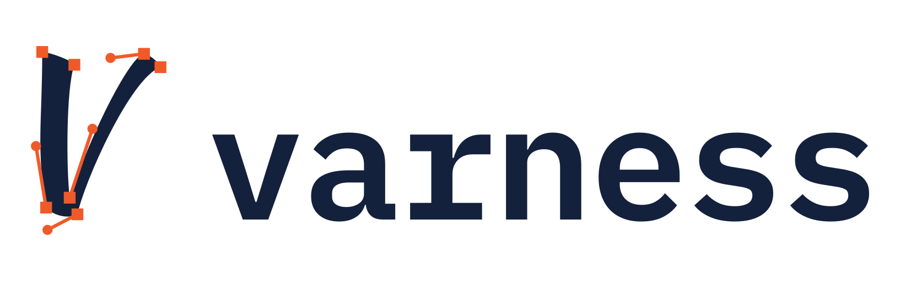

<p align="center">
  <picture>
    <source media="(prefers-color-scheme: dark)" srcset="assets/varness-lockup-dark.svg">
    
  </picture>
</p>

# varness

**Render-in-the-loop харнесс для ИИ-агентов, которые рисуют SVG-логотипы.**

LLM пишет SVG вслепую. varness рендерит каждую версию, измеряет её по пикселям, собирает
контакт-лист, который агент сам смотрит как картинку, ведёт историю итераций и собирает
продакшн-набор (favicon, иконки приложений, моно-версии). Всё работает локально, без API-ключей.

```
brief → 3–5 концептов → varness compare → выбор → [правка → varness check --sheet --track]×N → varness export
```

Почему пришлось написать свой: см. [обзор существующих харнессов](docs/landscape.md). Коротко: лучший
из найденных ([kaankiziltug/logo-design-skill](https://github.com/kaankiziltug/logo-design-skill)) проверяет
только XML, а не отрендеренные пиксели. Остальные решения либо обёртки над платными API, либо
исследовательские модели, которым нужен GPU.

| контакт-лист (`varness check --sheet`) | сравнение концептов (`varness compare`) |
|---|---|
|  |  |

## Что проверяется

Сначала структура: SVG разбирается как XML. Потом всё остальное по настоящему рендеру (resvg).

| категория | проверки |
|---|---|
| **integrity** | парсинг, `viewBox`, живой `<text>`, `<image>`, внешние ссылки, скрипты, битые `url(#id)`, циклы и длинные цепочки `<use>`, глубина вложенности, фильтры и маски, пустой рендер |
| **scalability** | доля «чернил» тоньше 1px и просветов уже 1px при 64/32/16px (морфологическое открытие и закрытие октагоном ≈ кругом диаметром в один целевой пиксель, поэтому диагональные штрихи оцениваются так же, как прямые). Для широких локапов «32px» значит 32px по высоте |
| **composition** | поля, касание края, смещение bbox, центр масс, «недозаполненный» холст. Подсказка даёт готовый `viewBox` или `translate`; если рисунок обрезан холстом, `viewBox` считается по всему рисунку. Property-тесты проверяют, что применённая подсказка снимает находку |
| **color** | палитра по пикселям, структура, которая держится только на цвете (моно-версия её теряет), цвета одинаковой светлоты (теряются в сером), белые «фальшивые дырки», контраст на белом, чёрном и брендовом фоне |
| **simplicity** | число команд пути, число элементов, сложность контура относительно круга |

Каждая находка содержит код, понятное сообщение и конкретную правку в единицах `viewBox`. Итоговый
`score` от 0 до 100 — это **технический гейт**. Оригинальность и соответствие бренду он не оценивает:
это задача агента, который смотрит на лист, и пользователя.

## Как проверяется сам varness

Метрики varness — это код, который пишет и правит LLM, поэтому он проверяется так же строго, как ДП-решения
(подробности и аудит — в [docs/verification.md](docs/verification.md)):

- **эталоны и дифференциальные тесты.** У каждой быстрой функции (морфология O(N) через интегральные
  изображения, палитра через `bincount`, центр масс, bbox) есть brute-версия «по определению» в
  `tests/reference.py`, и Hypothesis сверяет их на входах, смещённых к краям: пустые массивы,
  1 пиксель, окно больше массива, рисунок у самой границы;
- **метаморфные свойства на рендерах:** инвариантность к масштабу, зеркалу и цвету, пороги «1 целевой
  пиксель» для штрихов и просветов под любым углом, проверка подсказок;
- **фазз случайными SVG** (вырожденные холсты, фигуры за пределами холста, нулевые размеры, маски,
  `currentColor`, крошечные `matrix`): `check` не падает и выдаёт согласованный отчёт; `clean()` и
  моно-версии рисуют то же самое, что оригинал;
- **бюджеты по времени и памяти** на худших входах, включая те, что раньше роняли процесс.

## Установка

```bash
pip install "git+https://github.com/hexxii22/varness"            # CLI: numpy, Pillow, resvg-py
pip install "varness[fonts] @ git+https://github.com/hexxii22/varness" uharfbuzz   # + обводка текста с кернингом
pip install "varness[build] @ git+https://github.com/hexxii22/varness"   # + varness build (skia-pathops)
varness doctor
```

Рендереры: `resvg-py` (по умолчанию, ставится из pip), `cairosvg`, `rsvg-convert`, `resvg`, `inkscape`.
Выбор через `--renderer` или `VARNESS_RENDERER`.

## Команды

```bash
varness check logo.svg [-v] [--json] [--sheet sheet.png] [--track brand --note "что поменял"] [--bg "#0b1e3f"] [--strict]
varness compare concepts/*.svg -o compare.png [--json] [--similar 0.8]
varness sheet logo.svg -o sheet.png [--bg "#hex"] [--grid 8x8|thirds|golden|keyline|radial:N]
varness build logo.json -o logo.svg
varness history brand [--restore v003 -o logo.svg]
varness outline wordmark-src.svg -o wordmark.svg [--font Brand-Bold.otf]
varness export logo.svg -o dist --name brand [--app-bg "#hex"] [--force]
varness render logo.svg --size 1024 -o logo.png [--bg "#fff"]
```

Пример: черновик [`examples/orbit/draft.svg`](examples/orbit/draft.svg) и его исправленная версия
[`fixed.svg`](examples/orbit/fixed.svg). Ниже реальный вывод:

```
$ varness check logo.svg --track orbit --note "first draft"
logo.svg — 73/100  WARN   (renderer: resvg-py, sha 615540796884)
  integrity    ██████████  98
  scalability  ████░░░░░░  42
  composition  █████░░░░░  47
  color        █████████░  90
  simplicity   ██████████ 100
findings:
  WARN thin-at-64           10% of the ink is hairline (under 1px even at 64px).
                            → Nothing should be thinner than ~16 units.
  WARN thin-at-32           11% of the ink is thinner than 1px at 32px and will vanish or blur.
                            → Thicken strokes/details to ≥16 units (≥32 is comfortable).
  WARN off-center           Artwork bounding box is off-centre by (-7.0%, -5.1%) of the canvas.
                            → Wrap the art in <g transform="translate(36 26)"> or adjust the viewBox.
  WARN white-knockout       19% of the ink is white: fake knockouts show as white blobs on dark/colour backgrounds.
                            → Cut real holes (fill-rule='evenodd' or subtract the shape) so the background shows through.
  (+2 INFO, use -v to show)
metrics: coverage 23% · extent 68%×68% · bbox offset (-7.0%, -5.1%) · symmetry lr 1.0 tb 0.998
         thin/gap @64 10%/0% · @32 11%/0% · @16 11%/0% · mono loss 0% · gray loss 0%
         palette #2a6f97(80%) #ffffff(19%)
history: v001 = 73/100

$ varness check logo.svg --track orbit --note "real hole, centred, thicker ring"
logo.svg — 93/100  PASS  ✓ ship-ready   (renderer: resvg-py, sha 2ccc35b71088)
...
history: v002 = 93/100 · +20 vs v001 · fixed: off-center, thin-at-32, thin-at-64, white-knockout
```

`export` собирает: очищенный мастер-SVG, чёрную и белую версии SVG, PNG от 16 до 1024px, `favicon.ico`
(16/32/48), `apple-touch-icon.png`, иконки PWA 192/512 и maskable, `site.webmanifest`, `head-snippet.html`,
`sheet.png` и `report.json`. Если логотип не прошёл проверку (FAIL), экспорт откажется без `--force`.

## Построение фигур: `varness build`

Агент, который считает дуги и «дырки» вручную, ошибается: срезает концы дуг не по радиусу, рисует белое
поверх цветного вместо настоящего выреза. `build` принимает JSON-описание того, *что* нарисовать,
и сам считает кривые, булевы операции и скругления (через skia-pathops, точные кривые, не растр):

```json
{"snap": 8, "layers": [
  {"fill": "#14213d", "shape": {"subtract": [
     {"rect": [48, 48, 416, 416], "r": 96},
     {"ngon": [256, 256, 152, 5], "star": 64, "r": 12}]}},
  {"fill": "#fca311", "shape": {"circle": [128, 128, 24], "repeat": 4}}
]}
```

| ключ | что это |
|---|---|
| `circle [cx, cy, r]` · `ring [cx, cy, R, r]` | круг, кольцо |
| `arc [cx, cy, R, r, a0, a1]` | сектор кольца с радиальными срезами; углы в градусах, 0° = 12 часов, по часовой. `r = 0` даёт сектор круга |
| `rect [x, y, w, h]` · `polygon [[x, y] или [x, y, r_угла] или {"polar": [r, угол], "about": [x, y], "r": r_угла}, …]` · `ngon [cx, cy, R, n]` (+ `star`: внутренний радиус, `rot`) | многоугольники; `"r"` скругляет все углы настоящей касательной дугой (радиус ужимается, если не помещается); радиус у отдельной точки важнее, `0` оставляет угол острым (нужно для точек на оси `mirror`) |
| `union` · `subtract` · `intersect` `[фигуры…]` | булевы операции; `subtract` вырезает из первой фигуры остальные: настоящее негативное пространство |
| `translate [dx, dy]` · `rotate a` или `[a, x, y]` · `mirror "x"\|"y"` · `repeat n` или `[n, x, y]` | модификаторы у любой фигуры; вращение и повтор по умолчанию вокруг центра холста, `mirror` добавляет отражённую копию |
| `snap` | шаг сетки: каждая координата и радиус вне шага дают предупреждение (углы не проверяются) |
| `size` · `title` | холст (512 или `[w, h]`) и `<title>` |

Пример: [`examples/badge/badge.json`](examples/badge/badge.json). Дальше обычный цикл: `varness check logo.svg --sheet …`.
Композиционные сетки на листе диагностики: `--grid thirds | golden | keyline` (keyline-сетка иконок Material:
круг, квадрат, вертикальный и горизонтальный прямоугольники) `| radial:12` (лучи от 12 часов, как углы в `build`).

## Использование с агентом (Claude Code, Codex, Gemini CLI)

Скилл лежит в [`skills/varness/SKILL.md`](skills/varness/SKILL.md): процесс, правила написания SVG,
расшифровка находок. Справочник по ремеслу: [`skills/varness/references/craft.md`](skills/varness/references/craft.md).

- **В этом репозитории** скилл уже подключён через `.claude/skills/varness`.
- **В другом проекте:** скопируйте `skills/varness` в `~/.claude/skills/` (или `.claude/skills/` проекта)
  и поставьте CLI через `pip`.
- **Как плагин Claude Code:** `/plugin marketplace add hexxii22/varness`, затем `/plugin install varness@varness`.

Главное правило скилла: агент не показывает SVG, который он сам не отрендерил и не посмотрел.

## Логотип varness

Логотип сделан этим же харнессом, по циклу из скилла: три раунда концептов в
[`logo/concepts/`](logo/concepts), каждый проверен `varness compare` и прочитан глазами. Идея: буква V
со своим **настоящим бизье-скелетом**. Квадратные узлы и ручки с ползунками взяты прямо из глифа V
шрифта Kaushan Script (OFL) скриптом [`glyph_skeleton.py`](logo/concepts/round3/glyph_skeleton.py).
Показаны только ручки, которые выходят за пределы буквы.

| файл | назначение |
|---|---|
| [`assets/varness.svg`](assets/varness.svg) / [`-dark`](assets/varness-dark.svg) | основной знак (светлый и тёмный фон) |
| [`assets/varness-lockup.svg`](assets/varness-lockup.svg) / [`-dark`](assets/varness-lockup-dark.svg) | знак + слово (IBM Plex Mono) |
| [`assets/varness-icon.svg`](assets/varness-icon.svg) | иконка приложения: кремовая буква на плашке |
| [`assets/varness-small.svg`](assets/varness-small.svg) / [`-dark`](assets/varness-small-dark.svg) | малые размеры (≤32px): буква без скелета |
| [`assets/brand/`](assets/brand) | `varness export`: favicon.ico, PNG 16–1024, iOS/PWA-иконки, моно-версии |
| [`assets/social-preview.png`](assets/social-preview.png) | превью для GitHub/соцсетей (1280×640) |

Первый знак проекта (V с узлом) и его концепты остались примером процесса в
[`examples/varness-logo/`](examples/varness-logo).

## Ограничения

- Метрики эвристические. Пороги подобраны под типичные логотипы и иконки; для намеренно тонких
  линейных логотипов предупреждения `thin-*` ожидаемы. Если отступление сделано осознанно, пишите в `--note` почему.
- Оценка не заменяет взгляд: оптическую компенсацию, ритм и смысл агент проверяет по листу.
- `outline` не поддерживает раздельные позиции `<tspan>` и вертикальный текст.

## Разработка

```bash
python -m venv .venv && .venv/bin/pip install -e '.[dev]' uharfbuzz   # dev включает skia-pathops
.venv/bin/pytest -q                                   # профиль ci: около 2 минут
VARNESS_TEST_PROFILE=deep .venv/bin/pytest -q         # в ~10 раз больше случайных входов
```

## Roadmap

- MCP-сервер поверх тех же команд (для агентов без shell).
- «Анти-клише» проверка: сходство силуэта с набором шаблонных форм.
- Генерация упрощённого favicon-варианта по находкам `busy-at-16`.
- Анимированные версии (SMIL/CSS) с проверкой статичного кадра.

Лицензия: MIT.
