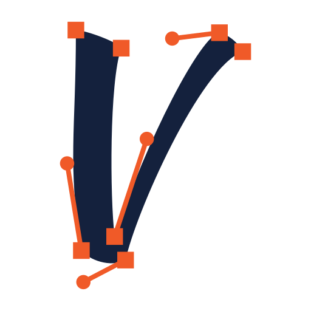
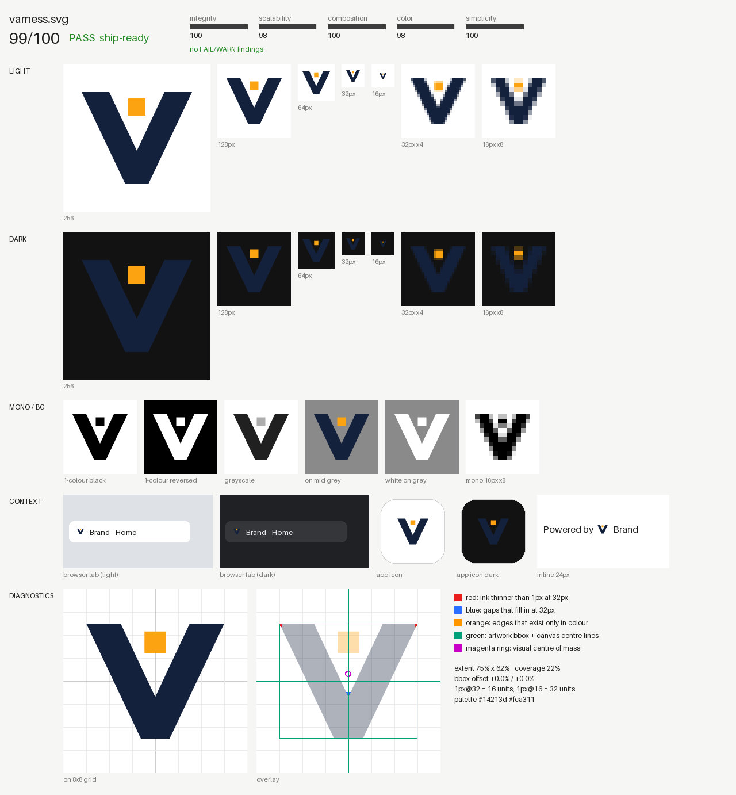
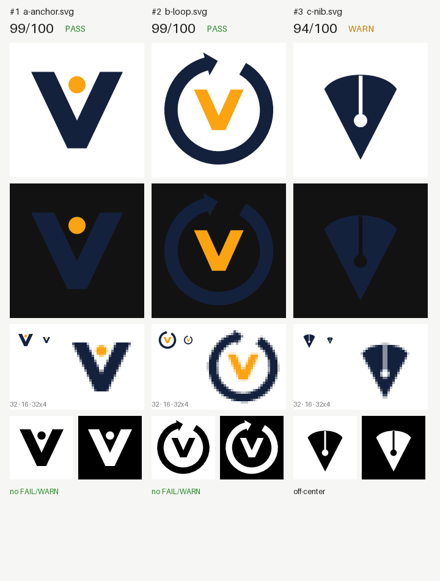

<p align="center"></p>

# varness

**Render-in-the-loop харнесс для ИИ-агентов, которые рисуют SVG-логотипы.**

LLM пишет SVG вслепую. varness рендерит каждую версию, измеряет её по пикселям, собирает
контакт-лист, который агент сам смотрит как картинку, ведёт историю итераций и собирает
продакшн-набор (favicon, иконки приложений, моно-версии). Всё работает локально, без API-ключей.

```
brief → 3–5 концептов → varness compare → выбор → [правка → varness check --sheet --track]×N → varness export
```

Почему пришлось написать свой: см. [обзор существующих харнессов](docs/landscape.md). Коротко: лучший
из найденных ([kaankiziltug/logo-design-skill](https://github.com/kaankiziltug/logo-design-skill)) проверяет
только XML, а не отрендеренные пиксели. Остальные решения либо обёртки над платными API, либо
исследовательские модели, которым нужен GPU.

| контакт-лист (`varness check --sheet`) | сравнение концептов (`varness compare`) |
|---|---|
|  |  |

## Что проверяется

Сначала структура: SVG разбирается как XML. Потом всё остальное по настоящему рендеру (resvg).

| категория | проверки |
|---|---|
| **integrity** | парсинг, `viewBox`, живой `<text>`, `<image>`, внешние ссылки, скрипты, битые `url(#id)`, фильтры и маски, пустой рендер |
| **scalability** | доля «чернил» тоньше 1px и просветов уже 1px при 64/32/16px (морфологическое открытие и закрытие). Для широких локапов «32px» значит 32px по высоте |
| **composition** | поля, касание края, смещение bbox, центр масс, «недозаполненный» холст. Подсказка даёт готовый `viewBox` и `translate` |
| **color** | палитра по пикселям, структура, которая держится только на цвете (моно-версия её теряет), цвета одинаковой светлоты (теряются в сером), белые «фальшивые дырки», контраст на белом, чёрном и брендовом фоне |
| **simplicity** | число команд пути, число элементов, сложность контура относительно круга |

Каждая находка содержит код, понятное сообщение и конкретную правку в единицах `viewBox`. Итоговый
`score` от 0 до 100 — это **технический гейт**. Оригинальность и соответствие бренду он не оценивает:
это задача агента, который смотрит на лист, и пользователя.

## Установка

```bash
pip install "git+https://github.com/hexxii22/varness"            # CLI: numpy, Pillow, resvg-py
pip install "varness[fonts] @ git+https://github.com/hexxii22/varness" uharfbuzz   # + обводка текста с кернингом
varness doctor
```

Рендереры: `resvg-py` (по умолчанию, ставится из pip), `cairosvg`, `rsvg-convert`, `resvg`, `inkscape`.
Выбор через `--renderer` или `VARNESS_RENDERER`.

## Команды

```bash
varness check logo.svg [-v] [--json] [--sheet sheet.png] [--track brand --note "что поменял"] [--bg "#0b1e3f"] [--strict]
varness compare concepts/*.svg -o compare.png [--json] [--similar 0.8]
varness sheet logo.svg -o sheet.png [--bg "#hex"]
varness history brand [--restore v003 -o logo.svg]
varness outline wordmark-src.svg -o wordmark.svg [--font Brand-Bold.otf]
varness export logo.svg -o dist --name brand [--app-bg "#hex"] [--force]
varness render logo.svg --size 1024 -o logo.png [--bg "#fff"]
```

Пример: черновик [`examples/orbit/draft.svg`](examples/orbit/draft.svg) и его исправленная версия
[`fixed.svg`](examples/orbit/fixed.svg). Ниже реальный вывод:

```
$ varness check logo.svg --track orbit --note "first draft"
logo.svg — 75/100  WARN   (renderer: resvg-py, sha 615540796884)
  integrity    ██████████  98
  scalability  █████░░░░░  50
  composition  █████░░░░░  47
  color        █████████░  90
  simplicity   ██████████ 100
findings:
  WARN thin-at-64           2% of the ink is hairline (under 1px even at 64px).
                            → Nothing should be thinner than ~16 units.
  WARN thin-at-32           11% of the ink is thinner than 1px at 32px and will vanish or blur.
                            → Thicken strokes/details to ≥16 units (≥32 is comfortable).
  WARN off-center           Artwork bounding box is off-centre by (-7.0%, -5.1%) of the canvas.
                            → Wrap the art in <g transform="translate(36.0 26.0)"> or adjust the viewBox.
  WARN white-knockout       19% of the ink is white: fake knockouts show as white blobs on dark/colour backgrounds.
                            → Cut real holes (fill-rule='evenodd' or subtract the shape) so the background shows through.
  (+3 INFO, use -v to show)
metrics: coverage 23% · extent 68%×68% · bbox offset (-7.0%, -5.1%) · symmetry lr 1.0 tb 0.998
         thin/gap @64 2%/0% · @32 11%/0% · @16 11%/26% · mono loss 0% · gray loss 0%
         palette #2a6f97(80%) #ffffff(19%)
history: v001 = 75/100

$ varness check logo.svg --track orbit --note "real hole, centred, thicker ring"
logo.svg — 93/100  PASS  ✓ ship-ready   (renderer: resvg-py, sha 2ccc35b71088)
...
history: v002 = 93/100 · +18 vs v001 · fixed: off-center, thin-at-32, thin-at-64, white-knockout
```

`export` собирает: очищенный мастер-SVG, чёрную и белую версии SVG, PNG от 16 до 1024px, `favicon.ico`
(16/32/48), `apple-touch-icon.png`, иконки PWA 192/512 и maskable, `site.webmanifest`, `head-snippet.html`,
`sheet.png` и `report.json`. Если логотип не прошёл проверку (FAIL), экспорт откажется без `--force`.

## Использование с агентом (Claude Code, Codex, Gemini CLI)

Скилл лежит в [`skills/varness/SKILL.md`](skills/varness/SKILL.md): процесс, правила написания SVG,
расшифровка находок. Справочник по ремеслу: [`skills/varness/references/craft.md`](skills/varness/references/craft.md).

- **В этом репозитории** скилл уже подключён через `.claude/skills/varness`.
- **В другом проекте:** скопируйте `skills/varness` в `~/.claude/skills/` (или `.claude/skills/` проекта)
  и поставьте CLI через `pip`.
- **Как плагин Claude Code:** `/plugin marketplace add hexxii22/varness`, затем `/plugin install varness@varness`.

Главное правило скилла: агент не показывает SVG, который он сам не отрендерил и не посмотрел.

## Пример: логотип самого varness

В [`examples/varness-logo/`](examples/varness-logo) лежат три концепта и финальная версия, сделанные
по этому процессу. `compare` поймал смещение центра у варианта «перо». Выбран вариант «V + узел»
(узел — опорная точка векторного пути), после доработки он ship-ready: 99/100.

## Ограничения

- Метрики эвристические. Пороги подобраны под типичные логотипы и иконки; для намеренно тонких
  линейных логотипов предупреждения `thin-*` ожидаемы. Если отступление сделано осознанно, пишите в `--note` почему.
- Оценка не заменяет взгляд: оптическую компенсацию, ритм и смысл агент проверяет по листу.
- `outline` не поддерживает раздельные позиции `<tspan>` и вертикальный текст.

## Разработка

```bash
python -m venv .venv && .venv/bin/pip install -e '.[dev]' uharfbuzz
.venv/bin/pytest -q
```

## Roadmap

- MCP-сервер поверх тех же команд (для агентов без shell).
- «Анти-клише» проверка: сходство силуэта с набором шаблонных форм.
- Генерация упрощённого favicon-варианта по находкам `busy-at-16`.
- Анимированные версии (SMIL/CSS) с проверкой статичного кадра.

Лицензия: MIT.
